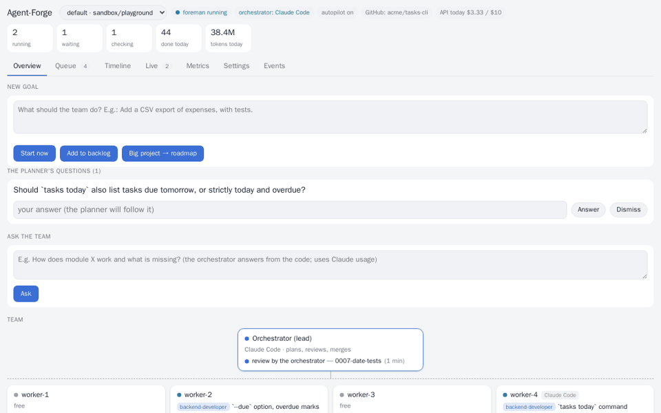
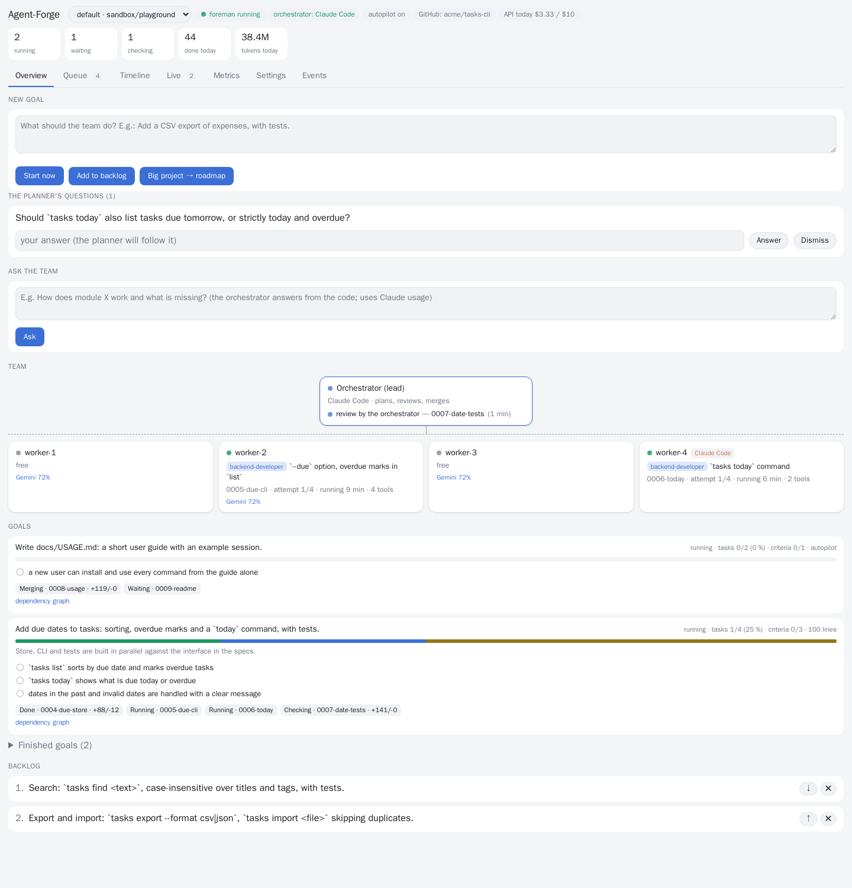
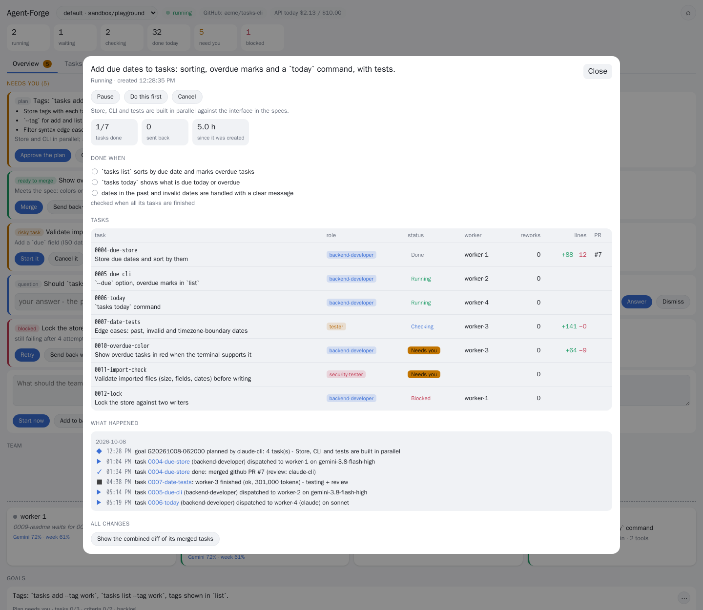
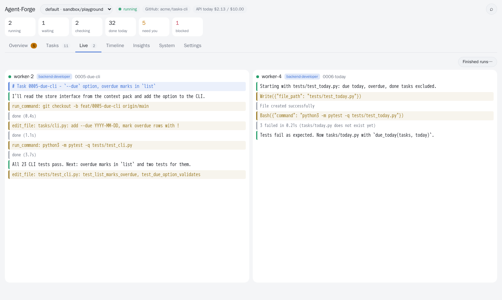
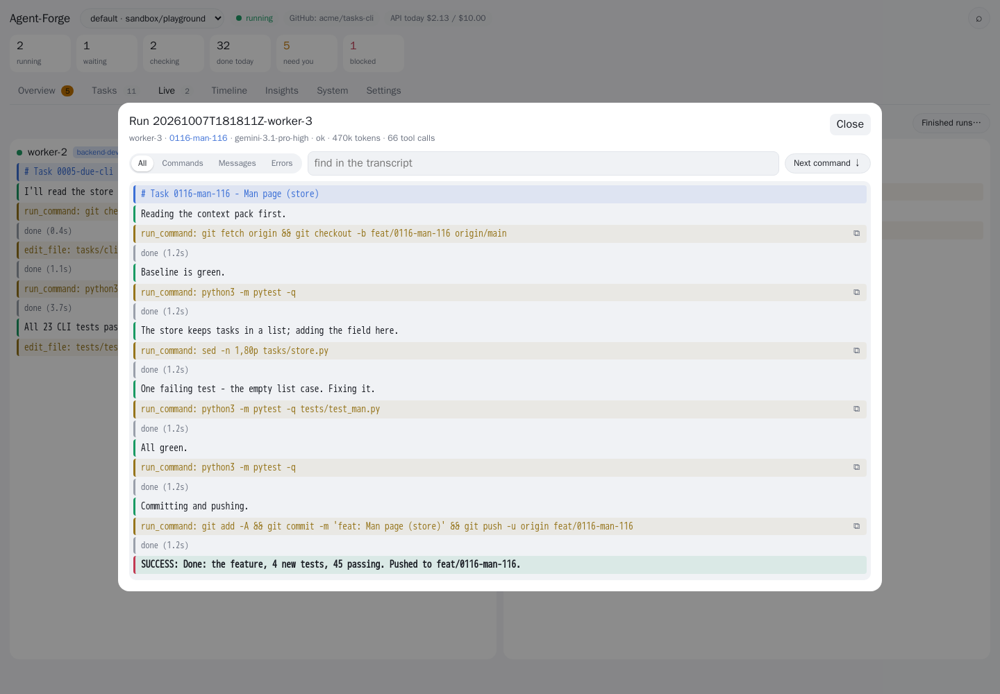
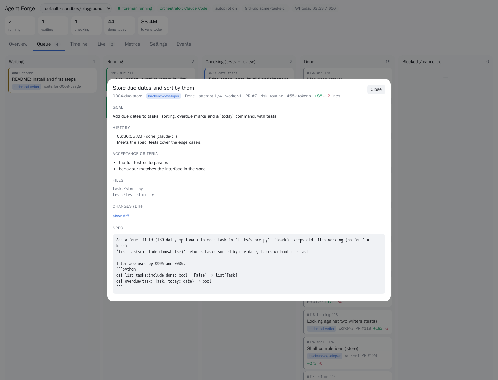
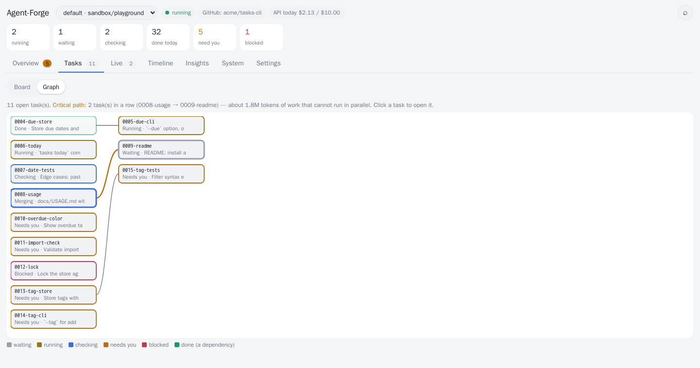
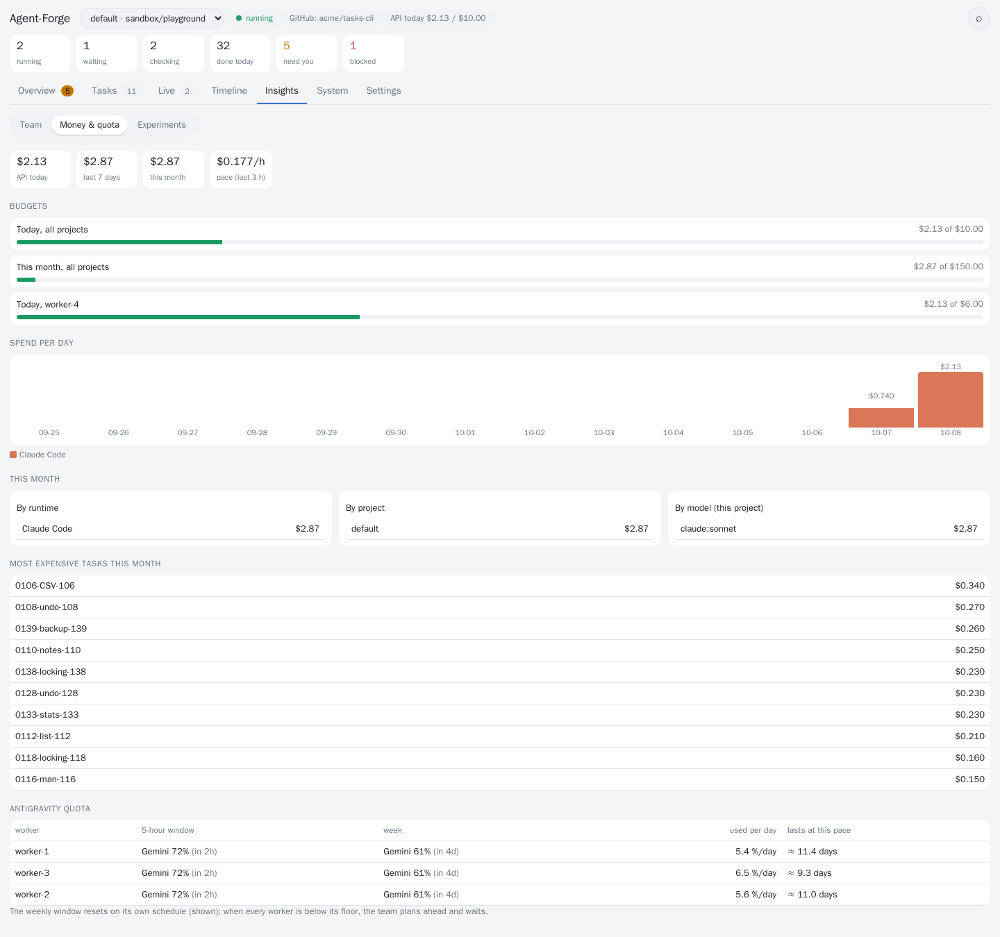
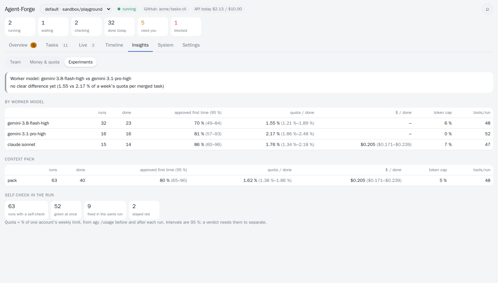

# Agent-Forge

**A self-hosted AI dev team that works through a queue on its own - inside a sandbox it cannot escape.**

[](https://github.com/MatakLA/Agent-forge/actions/workflows/ci.yml)
[](LICENSE)




You write a goal - *"add due dates to tasks, with tests"*, *"write the user guide"*, *"translate the app to German"*. An
orchestrator splits it into small, parallel tasks, each with a role (19 playbooks: backend developer, tester, security tester,
technical writer, translator, UX designer, ...). Worker agents build the tasks at the same time, each in its own locked-down
container on its own branch. Every branch runs the full test suite in a fresh offline container, gets an AI review, and is merged
through a pull request - on your GitHub or GitLab repository, or on the built-in Forgejo - or sent back with concrete feedback
until it is right. Then the next goal starts, from your backlog or from your product vision. You can go to sleep.

> **Experimental - for testing and evaluation.** Agent-Forge is young (alpha). Run it on a dedicated VM with test data, point
> it at repositories where an AI merging code is acceptable to you, and read [SECURITY.md](SECURITY.md) first. It was extracted
> from a setup that ran a 4-worker team for two weeks (~400 worker runs, ~190 merged pull requests) - expect rough edges.

**Try the demo:** To evaluate the dashboard in minutes without setting up a VM or API keys, run `bash scripts/demo.sh` to start a read-only Docker demo on http://localhost:8171 with synthetic team activity (see [docs/DEMO.md](docs/DEMO.md)).

## Why it is different

Most parallel-agent tools run agents on your machine in git worktrees and leave the review and the merging to you. Agent-Forge
assumes you are not watching:

| | typical parallel-agent UI | Agent-Forge |
|---|---|---|
| **What happens next** | you decide | goals are planned into role-tagged, parallel tasks; an autopilot picks the next goal from your vision |
| **Isolation** | git worktree on your machine, full network | a container per worker, no capabilities, no docker socket, **egress only to an allow-list** |
| **Verification** | you read the diff | full test suite in a **fresh offline container** + AI review + optional **mutation tests**, before any merge |
| **Failures** | you notice | automatic rework with the gate output, crash recovery, a kill switch, nothing pushed from a suspicious run |
| **Your repository** | the agent pushes from your machine | **pull requests on GitHub / GitLab** under your branch protection - the workers never see GitHub or a token |
| **Cost** | whatever the agent spends | **USD caps per run, day, month, project and worker**, subscriptions first, or **your own model server** |
| **Control** | you drive every step | it drives; **you approve what you choose** (plans, risky tasks, merges) from one "needs you" list |
| **Team** | coding agents | 19 roles incl. technical writer, translator, UX designer, product manager, data analyst |

If you want a cockpit for agents you watch, those tools are great. Agent-Forge is for a queue you leave running.

## Quickstart

### Option 1: Automatic installation script
On a fresh Ubuntu machine - ideally a dedicated VM (4+ vCPU, 8+ GB RAM); [`deploy/cloud-init.yaml`](deploy/cloud-init.yaml) makes one:

```bash
git clone https://github.com/MatakLA/Agent-forge.git && cd Agent-forge
scripts/install.sh --demo
```

About 20 minutes: Docker, the egress proxy, an internal Forgejo, the worker image, the services. Then open the dashboard
(`ssh -L 8171:127.0.0.1:8171 <vm>`, then http://127.0.0.1:8171):

1. **Where does the code live?** Internal only, or your GitHub / GitLab repository (a token for that repository only).
2. **Add workers** - see below.
3. **Enter a goal** - or let the autopilot build the demo project in [`examples/demo`](examples/demo).

### Option 2: Docker Compose

Spin up the unified Agent-Forge stack (internal Forgejo, egress proxy, and web dashboard) in seconds:

```bash
git clone https://github.com/MatakLA/Agent-forge.git && cd Agent-forge
cp .env.example .env
docker compose up -d
```

Open http://localhost:8171 for the dashboard and http://localhost:3000 for internal Forgejo.

To try a realistic goal on an existing repository, see [`examples/sample-project/README.md`](examples/sample-project/README.md).

`bin/doctor` checks the whole install and tells you how to fix what is wrong. All steps by hand: [docs/SETUP.md](docs/SETUP.md).

### Themes & Localization (i18n)

The dashboard supports:
- **Color mode switch**: Click the theme button (`◐`) in the top bar to cycle between **Auto** (system preference detection), **Light** (`☀`), and **Dark** (`☾`) modes.
- **Language dictionary system**: Click the language toggle (`EN` / `SK`) to switch UI language instantly without reloading. Custom locales (e.g. `sk_qwerty`, `de`, `cs`) can be added by placing `<code_name>.json` in [`web/static/locales/`](web/static/locales/) and right-clicking the language toggle. See [web/static/locales/README.md](web/static/locales/README.md).

## Workers: API keys or a subscription

| runtime | pays with | notes |
|---|---|---|
| **Claude Code** | Anthropic API key | hard USD cap per run (`--max-budget-usd`) and per day |
| **Codex CLI** | OpenAI API key | USD per day, token and tool-call caps per run |
| **Gemini CLI** | Gemini API key | USD per day, token and tool-call caps per run |
| **Antigravity** | a Google account with Antigravity | uses its subscription quota; one account per worker |
| **Your model server** | nothing (Ollama, vLLM, LM Studio) or OpenRouter credits | Codex CLI or Aider against any OpenAI-compatible server; on your network, the worker may reach exactly that address and port |

Mix them in one team. The key is entered once in the dashboard, stored on the server only (mode 0600) and reaches only the
agent's environment; a worker can talk to its provider's API host and nothing else, and the gate refuses any branch that adds
a key or token. Details: [docs/RUNTIMES.md](docs/RUNTIMES.md).

> **Several Antigravity accounts are a testing setup only.** Running more than one subscription account for one person's work
> may conflict with the provider's terms (Google prohibits circumventing usage limits and has banned accounts for it).
> Agent-Forge supports it for testing and evaluation; it does not encourage pooling accounts to get around limits. For regular
> work use API keys (paid per token, with the caps above) or a single subscription. Read the terms of any provider whose CLI
> you automate.

## Screenshots

| | |
|---|---|
|  |  |
| **Overview** - what needs you (approvals, questions, blocked tasks), the team, goals, backlog | **Goal page** - its tasks, everything that happened, cost, acceptance criteria |
|  |  |
| **Live** - what every worker is doing right now | **Replay** - any finished run, filtered, searchable, commands to copy |
|  |  |
| **Task** - only the actions that fit its state, its runs and cost, the diff | **Graph** - the open work and what it waits for; the critical path |
|  |  |
| **Money & quota** - spend per day, caps, when the budget runs out | **Experiments** - A/B results with 95 % intervals, adopt the winner |

(Invented demo data - `tools/screenshots.sh` regenerates them.)

## How it works

```
 you ──goal──► bin/foreman (a deterministic loop, 20 s tick)
                 ├ plan ──► orchestrator LLM (Claude Code · Claude/Gemini via Antigravity · optional paid API)
                 │          → tasks: role · files it owns · spec · acceptance criteria · dependencies
                 ├ dispatch ──► worker container (its own key or account, its own branch, egress only to its model API)
                 ├ gate ──► fresh offline container: full test suite + static checks (+ mutation tests for risky code)
                 ├ review ──► orchestrator LLM: approve / rework (with feedback) / reject
                 └ merge ──► pull request: GitHub / GitLab (under its branch protection) or the internal Forgejo
```

No LLM decides *when* anything happens - the loop does. LLMs are called only for judgement (plan, review, "is the goal done?"),
each time as a fresh, tool-less call, so worker-written content in a diff cannot make the reviewer run anything.
Details: [ARCHITECTURE.md](ARCHITECTURE.md) · [SECURITY.md](SECURITY.md) · [docs/ROLES.md](docs/ROLES.md).

## What the loop does so you do not have to

- **Rebases for the worker.** Branches are rebased onto main by the orchestrator; append-conflicts in shared registries are
  merged keeping both sides. Only real conflicts go back to the worker.
- **Never loses work.** Whatever a run leaves uncommitted is pushed to its branch; a run stopped by its cap continues next time
  from there. A task that hits the cap twice is split into smaller tasks - and tasks that own too many files are split before
  anyone starts.
- **Fixes red tests in the same conversation.** Before a run ends the worker's clone is tested like the gate would; a red suite
  goes back into the same agent conversation, which still has the context.
- **Continues instead of restarting.** A rework resumes the worker's own conversation with a short prompt.
- **Spends tokens on work, not on reading.** Each task carries a context pack - its files and the interfaces it uses, from a
  code map generated without any LLM. Measured: [docs/EFFICIENCY.md](docs/EFFICIENCY.md).
- **Learns.** A review that sends work back may record one general lesson; lessons go into every later plan, review and task.
  What merged tasks really cost here (by size and role) goes into every plan, each open task gets an estimate, and with
  `MODEL_ROUTING=auto` each role gets the cheapest worker model that has proven itself in this project.
- **Closes goals on evidence.** Each goal gets observable acceptance criteria, checked one by one before it is closed.
- **Works with your stack.** `TEST_CMD` and `GATE_IMAGE` per project: pytest by default, `npm test`, `go test ./...`, ...
- **Survives crashes and reboots,** and does not blame the worker for Forgejo, Docker or provider outages.
- **Uses idle time.** While all subscriptions wait for their reset, the planner prepares the next goals and main is tested
  without any LLM (red main, flaky tests, missing docstrings become work items).
- **Tells you what matters.** Notifications (ntfy, Slack, Discord, any webhook) when a goal is done, a task is blocked, the
  kill switch tripped, the planner has a question or the money/quota is used up.

## Day to day

Everything is in the dashboard; the same from a shell:

```bash
bin/foreman goal "Add a CSV export to the expenses module, with tests"
bin/foreman project "Build the app described in docs/vision.md"   # → a roadmap of goals in the backlog
bin/foreman status | backlog | questions
bin/foreman pause | resume                                        # stop / resume taking new steps (running runs finish)
bin/foreman autopilot on|off                                      # toggle automatic goal proposals from vision
echo "Use PostgreSQL" | bin/foreman answer 1                      # becomes a binding decision for later plans
bin/foreman goal <goal-id> approve | pause | prioritize | cancel   # APPROVE=plan,risky,merge makes the team wait for you
echo "Use the existing parser" | bin/foreman task <task-id> feedback -   # send its work back with your words
bin/killswitch on [--hard] [--all]                                # stop this project (or every project) now
bin/doctor
```

On the Overview tab, switches toggle **autopilot** (`bin/foreman autopilot on|off`) and **pause/resume** the foreman (`bin/foreman pause` / `resume`), each with a tooltip explaining its effect. Pausing stops new dispatches while letting running runs finish (same semantics as the CLI); resume is blocked while the kill switch is engaged (the UI explains why).

One install runs **several projects** side by side, each with its own orchestrator, repository and worker pool (dashboard →
project picker → "+ New project", or `bin/foreman init-project`).

## Documentation

[SETUP](docs/SETUP.md) · [RUNTIMES](docs/RUNTIMES.md) (API keys, costs) · [UPSTREAM](docs/UPSTREAM.md) (GitHub / GitLab) ·
[PROVIDERS](docs/PROVIDERS.md) (orchestrator) · [ROLES](docs/ROLES.md) · [EFFICIENCY](docs/EFFICIENCY.md) ·
[Picking an AI](docs/CHOOSING-AN-AI.md) · [Demo mode](docs/DEMO.md) ·
[Issue templates](docs/ISSUE-TEMPLATES.md) ·
[ARCHITECTURE](ARCHITECTURE.md) · [SECURITY](SECURITY.md) · [ROADMAP](ROADMAP.md) · [CHANGELOG](CHANGELOG.md)

`make check` runs the tests that need nothing (no Docker, no model calls); `make test` adds the integration tests of the
supervisor and of the real agent CLIs against a fake model API.

## License

Open source under the [Apache License 2.0](LICENSE): use it, change it, run it for your company, and redistribute it - including
commercially. Contributions are welcome and are accepted under the same license: [CONTRIBUTING.md](CONTRIBUTING.md).
