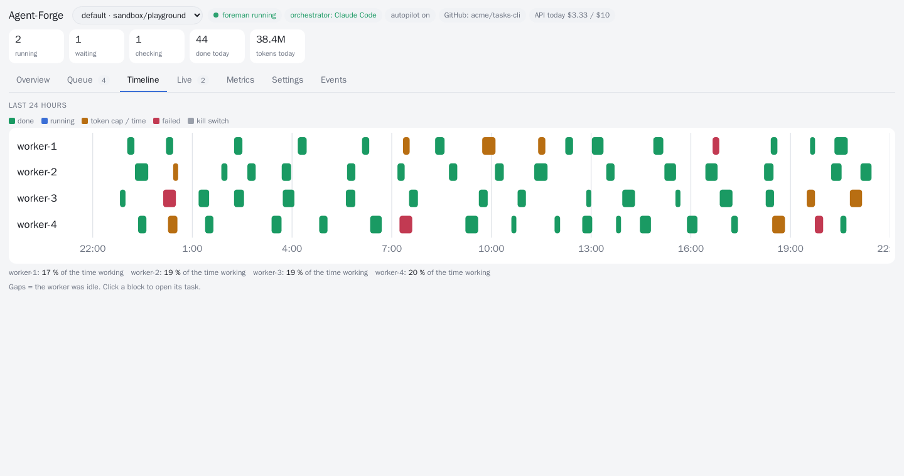
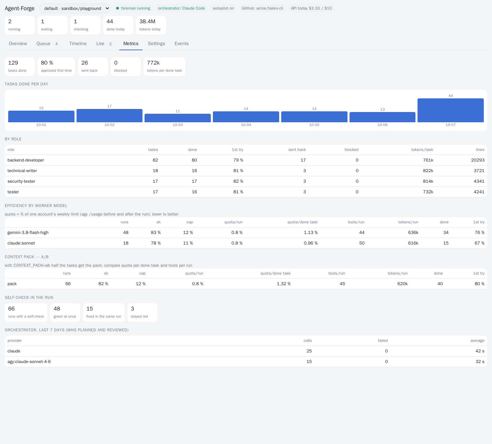
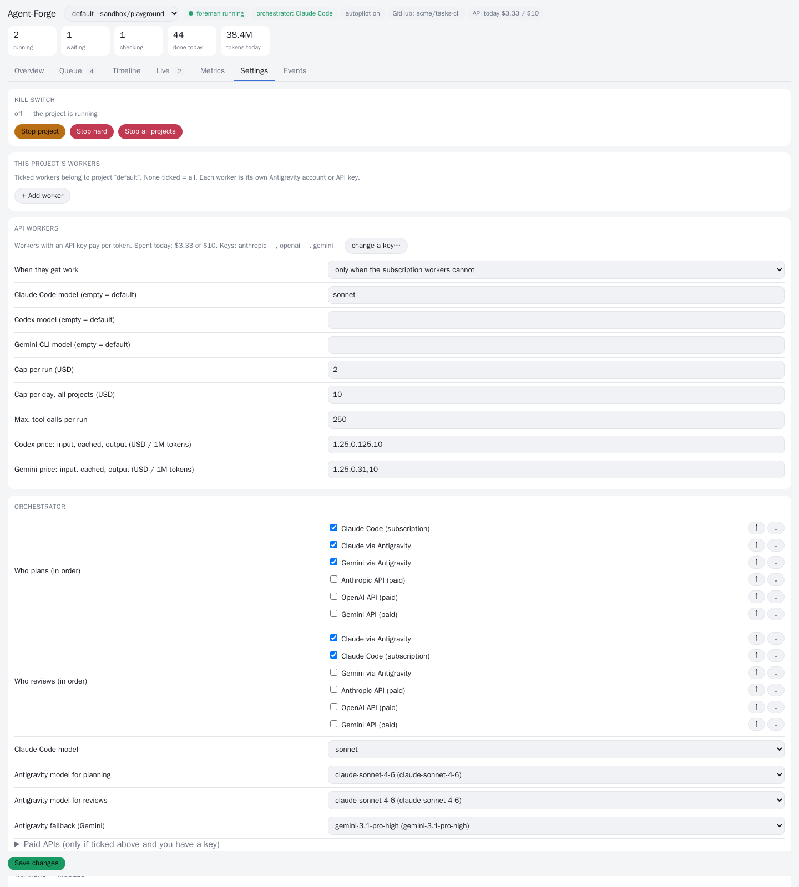

# Agent-Forge

**A self-hosted AI dev team that works through a queue on its own - inside a sandbox it cannot escape.**

[-blue)](LICENSE)


You write a goal - *"add due dates to tasks, with tests"*, *"write the user guide"*, *"translate the app to German"*. An
orchestrator splits it into small, parallel tasks, each with a role (19 playbooks: backend developer, tester, security tester,
technical writer, translator, UX designer, ...). Worker agents build the tasks at the same time, each in its own locked-down
container on its own branch. Every branch runs the full test suite in a fresh offline container, gets an AI review, and is merged
through a pull request - on your GitHub or GitLab repository, or on the built-in Forgejo - or sent back with concrete feedback
until it is right. Then the next goal starts, from your backlog or from your product vision. You can go to sleep.

> **Experimental - for testing and evaluation.** Agent-Forge is young (alpha). Run it on a dedicated VM with test data, point
> it at repositories where an AI merging code is acceptable to you, and read [SECURITY.md](SECURITY.md) first. It was extracted
> from a setup that ran a 4-worker team for two weeks (~400 worker runs, ~190 merged pull requests) - expect rough edges.

## Why it is different

Most parallel-agent tools run agents on your machine in git worktrees and leave the review and the merging to you. Agent-Forge
assumes you are not watching:

| | typical parallel-agent UI | Agent-Forge |
|---|---|---|
| **What happens next** | you decide | goals are planned into role-tagged, parallel tasks; an autopilot picks the next goal from your vision |
| **Isolation** | git worktree on your machine, full network | a container per worker, no capabilities, no docker socket, **egress only to an allow-list** |
| **Verification** | you read the diff | full test suite in a **fresh offline container** + AI review + optional **mutation tests**, before any merge |
| **Failures** | you notice | automatic rework with the gate output, crash recovery, a kill switch, nothing pushed from a suspicious run |
| **Your repository** | the agent pushes from your machine | **pull requests on GitHub / GitLab** under your branch protection - the workers never see GitHub or a token |
| **Cost** | whatever the agent spends | **USD caps per run and per day**, subscriptions first, measured quota / cost per merged task |
| **Team** | coding agents | 19 roles incl. technical writer, translator, UX designer, product manager, data analyst |

If you want a cockpit for agents you watch, those tools are great. Agent-Forge is for a queue you leave running.

## Quickstart

On a fresh Ubuntu machine - ideally a dedicated VM (4+ vCPU, 8+ GB RAM); [`deploy/cloud-init.yaml`](deploy/cloud-init.yaml) makes one:

```bash
git clone https://github.com/<you>/agent-forge && cd agent-forge
scripts/install.sh --demo
```

About 20 minutes: Docker, the egress proxy, an internal Forgejo, the worker image, the services. Then open the dashboard
(`ssh -L 8171:127.0.0.1:8171 <vm>`, then http://127.0.0.1:8171):

1. **Where does the code live?** Internal only, or your GitHub / GitLab repository (a token for that repository only).
2. **Add workers** - see below.
3. **Enter a goal** - or let the autopilot build the demo project in [`examples/demo`](examples/demo).

`bin/doctor` checks the whole install and tells you how to fix what is wrong. All steps by hand: [docs/SETUP.md](docs/SETUP.md).

## Workers: API keys or a subscription

| runtime | pays with | notes |
|---|---|---|
| **Claude Code** | Anthropic API key | hard USD cap per run (`--max-budget-usd`) and per day |
| **Codex CLI** | OpenAI API key | USD per day, token and tool-call caps per run |
| **Gemini CLI** | Gemini API key | USD per day, token and tool-call caps per run |
| **Antigravity** | a Google account with Antigravity | uses its subscription quota; one account per worker |

Mix them in one team. The key is entered once in the dashboard, stored on the server only (mode 0600) and reaches only the
agent's environment; a worker can talk to its provider's API host and nothing else, and the gate refuses any branch that adds
a key or token. Details: [docs/RUNTIMES.md](docs/RUNTIMES.md).

> **Several Antigravity accounts are a testing setup only.** Running more than one subscription account for one person's work
> may conflict with the provider's terms (Google prohibits circumventing usage limits and has banned accounts for it).
> Agent-Forge supports it for testing and evaluation; it does not encourage pooling accounts to get around limits. For regular
> work use API keys (paid per token, with the caps above) or a single subscription. Read the terms of any provider whose CLI
> you automate.

## Screenshots

| | |
|---|---|
|  |  |
| **Overview** - goals with acceptance criteria, the team, backlog, questions | **Live** - what every worker is doing right now |
|  |  |
| **Timeline** - 24 h of runs per worker, click to open the task | **Metrics** - first-pass rate, quota and cost per merged task |
|  |  |
| **Task** - spec, history, review feedback, diff | **Settings** - kill switch, workers, models, budgets, notifications |

(Invented demo data - `tools/screenshots.sh` regenerates them.)

## How it works

```
 you ──goal──► bin/foreman (a deterministic loop, 20 s tick)
                 ├ plan ──► orchestrator LLM (Claude Code · Claude/Gemini via Antigravity · optional paid API)
                 │          → tasks: role · files it owns · spec · acceptance criteria · dependencies
                 ├ dispatch ──► worker container (its own key or account, its own branch, egress only to its model API)
                 ├ gate ──► fresh offline container: full test suite + static checks (+ mutation tests for risky code)
                 ├ review ──► orchestrator LLM: approve / rework (with feedback) / reject
                 └ merge ──► pull request: GitHub / GitLab (under its branch protection) or the internal Forgejo
```

No LLM decides *when* anything happens - the loop does. LLMs are called only for judgement (plan, review, "is the goal done?"),
each time as a fresh, tool-less call, so worker-written content in a diff cannot make the reviewer run anything.
Details: [ARCHITECTURE.md](ARCHITECTURE.md) · [SECURITY.md](SECURITY.md) · [docs/ROLES.md](docs/ROLES.md).

## What the loop does so you do not have to

- **Rebases for the worker.** Branches are rebased onto main by the orchestrator; append-conflicts in shared registries are
  merged keeping both sides. Only real conflicts go back to the worker.
- **Never loses work.** Whatever a run leaves uncommitted is pushed to its branch; a run stopped by its cap continues next time
  from there. A task that hits the cap twice is split into smaller tasks - and tasks that own too many files are split before
  anyone starts.
- **Fixes red tests in the same conversation.** Before a run ends the worker's clone is tested like the gate would; a red suite
  goes back into the same agent conversation, which still has the context.
- **Continues instead of restarting.** A rework resumes the worker's own conversation with a short prompt.
- **Spends tokens on work, not on reading.** Each task carries a context pack - its files and the interfaces it uses, from a
  code map generated without any LLM. Measured: [docs/EFFICIENCY.md](docs/EFFICIENCY.md).
- **Learns.** A review that sends work back may record one general lesson; lessons go into every later plan, review and task.
- **Closes goals on evidence.** Each goal gets observable acceptance criteria, checked one by one before it is closed.
- **Works with your stack.** `TEST_CMD` and `GATE_IMAGE` per project: pytest by default, `npm test`, `go test ./...`, ...
- **Survives crashes and reboots,** and does not blame the worker for Forgejo, Docker or provider outages.
- **Uses idle time.** While all subscriptions wait for their reset, the planner prepares the next goals and main is tested
  without any LLM (red main, flaky tests, missing docstrings become work items).
- **Tells you what matters.** Notifications (ntfy, Slack, Discord, any webhook) when a goal is done, a task is blocked, the
  kill switch tripped, the planner has a question or the money/quota is used up.

## Day to day

Everything is in the dashboard; the same from a shell:

```bash
bin/foreman goal "Add a CSV export to the expenses module, with tests"
bin/foreman project "Build the app described in docs/vision.md"   # → a roadmap of goals in the backlog
bin/foreman status | backlog | questions
echo "Use PostgreSQL" | bin/foreman answer 1                      # becomes a binding decision for later plans
bin/killswitch on [--hard] [--all]                                # stop this project (or every project) now
bin/doctor
```

One install runs **several projects** side by side, each with its own orchestrator, repository and worker pool (dashboard →
project picker → "+ New project", or `bin/foreman init-project`).

## Documentation

[SETUP](docs/SETUP.md) · [RUNTIMES](docs/RUNTIMES.md) (API keys, costs) · [UPSTREAM](docs/UPSTREAM.md) (GitHub / GitLab) ·
[PROVIDERS](docs/PROVIDERS.md) (orchestrator) · [ROLES](docs/ROLES.md) · [EFFICIENCY](docs/EFFICIENCY.md) ·
[ARCHITECTURE](ARCHITECTURE.md) · [SECURITY](SECURITY.md) · [ROADMAP](ROADMAP.md) · [CHANGELOG](CHANGELOG.md)

`make check` runs the tests that need nothing (no Docker, no model calls); `make test` adds the integration tests of the
supervisor and of the real agent CLIs against a fake model API.

## License

**Source-available ("fair-code"), not open source in the OSI sense.** Agent-Forge is licensed under the Sustainable Use License
([LICENSE](LICENSE)): use it and change it for free - for yourself and inside your company - and share it free of charge for
non-commercial purposes. Selling it, offering it as a hosted or paid service, or otherwise making money from Agent-Forge itself
needs a commercial license ([LICENSE_EE.md](LICENSE_EE.md)). Contributions are welcome: [CONTRIBUTING.md](CONTRIBUTING.md).
