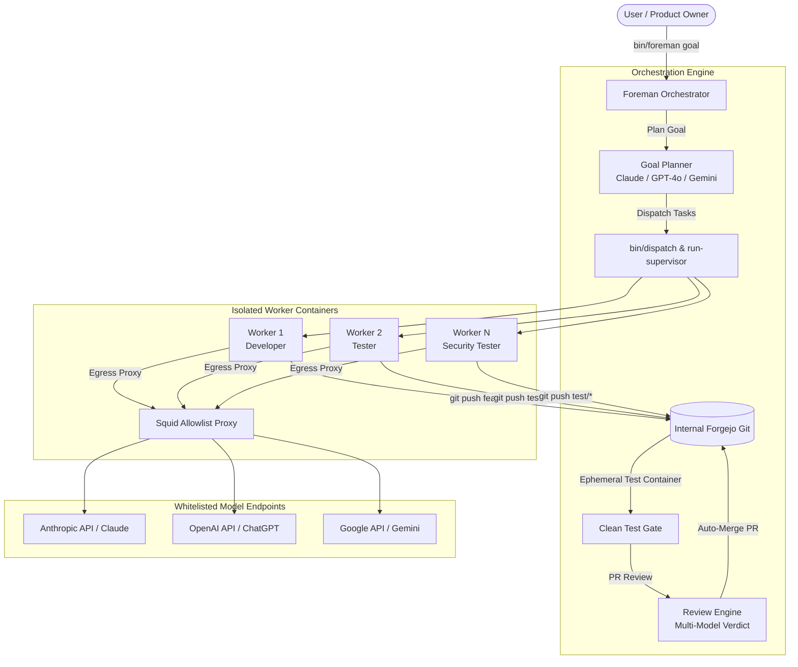

# Agent-Forge 🔨

> **Autonomous Multi-Agent Software Development Sandbox**  
> Orchestrate teams of AI coding workers (Claude, ChatGPT, Gemini) in isolated containers with automated testing gates, pull request reviews, and self-hosted Git forge integration.

---

## ⚡ Highlights

- **Multi-Provider AI Support:** Seamlessly plan and build with **Claude** (Anthropic), **ChatGPT / GPT-4o** (OpenAI), and **Gemini** (Google). Automatic fallback cascade prevents downtime when rate limits or quotas are reached.
- **True Engineering Team Lifecycle:** Tasks are planned with explicit roles (`backend developer`, `tester`, `security tester`, `fullstack developer`). Code is pushed to feature branches, verified in clean throwaway test containers, and merged via Pull Requests.
- **Ironclad Sandboxing:** Workers run as non-root users (`uid 1000`) with `cap_drop: ALL`, `no-new-privileges: true`, resource caps, and **NO** access to `/var/run/docker.sock`.
- **Strict Egress Whitelisting:** An internal Squid proxy blocks arbitrary internet connections and LAN subnets, restricting network traffic exclusively to approved model APIs and package registries.
- **Deterministic Orchestration:** A Python-based supervisory loop (`bin/foreman`) manages token budgets, execution timeouts, automatic rework loops, and blocked-task recovery without unmanaged LLM drift.
- **Zero Heavy Dependencies:** Core orchestrator runs on standard-library Python 3. Docker and Docker Compose handle containerization.

---

## 🏗️ Architecture



---

## 🚀 Quickstart

### 1. Prerequisites
- Linux host or VM (Ubuntu 22.04+ / Debian 12+)
- Docker Engine & Docker Compose (v2.20+)
- Python 3.10+
- Git

### 2. Clone & Setup Configuration
```bash
git clone https://github.com/your-org/agent-forge.git
cd agent-forge

# Initialize configurations from templates
cp etc/foreman.example.conf etc/foreman.conf
cp etc/limits.example.conf etc/limits.conf
cp .env.example .env
```

### 3. Configure API Credentials
You can provide API keys via `.env` or place them in `~/.config/sandbox/secrets/`:
```bash
# Example: configure Anthropic and OpenAI keys
export ANTHROPIC_API_KEY="sk-ant-..."
export OPENAI_API_KEY="sk-proj-..."
export GEMINI_API_KEY="AIzaSy..."
```

### 4. Start the Infrastructure
```bash
# 1. Start the internal Git server (Forgejo)
docker compose -f forgejo/docker-compose.yml up -d

# 2. Start the egress proxy
bin/egress-up

# 3. Provision worker containers (e.g. 4 workers)
bin/worker-up 1
bin/worker-up 2
bin/worker-up 3
bin/worker-up 4

# 4. Verify system baseline and run self-tests
bin/foreman --selftest
```

### 5. Launch the Foreman Orchestrator
```bash
# Run in foreground for inspection
bin/foreman run

# Or enable as a systemd service
sudo cp etc/systemd/sandbox-foreman.service /etc/systemd/system/
sudo systemctl daemon-reload
sudo systemctl enable --now sandbox-foreman.service
```

---

## 🎮 CLI Usage

### Queue a Feature Goal
```bash
bin/foreman goal "Add user authentication module with SQLite storage, bcrypt hashing, and comprehensive unit tests"
```

### Queue a Large Project (Roadmap Generation)
```bash
bin/foreman project "Build a full-featured personal budgeting CLI app with currency conversion and transaction reports"
```

### Monitor Team Status
```bash
# Real-time compact view of workers, active goals, and queue
bin/foreman status

# JSON output for dashboards
bin/foreman status --json
```

### Task & Goal Management
```bash
# Retry a blocked task (resets attempt counter)
bin/foreman retry 0142-auth-core

# Cancel a stuck or obsolete goal
bin/foreman cancel G20261005-010000

# Pause / Resume task dispatch
bin/foreman pause
bin/foreman resume

# Toggle vision-based autonomous autopilot
bin/foreman autopilot on
bin/foreman autopilot off
```

---

## ⚙️ Multi-Model Configuration (`etc/foreman.conf`)

Configure your preferred LLM provider for planning and reviewing:

```ini
# Options: auto | claude | openai | gemini
ORCHESTRATOR_PROVIDER=auto

# Model settings
CLAUDE_MODEL=sonnet
ANTHROPIC_MODEL=claude-3-7-sonnet-20250219
OPENAI_MODEL=gpt-4o
AGY_PLAN_MODEL=claude-sonnet-4-6
AGY_FALLBACK_MODEL=gemini-3.1-pro-high

# Concurrency & rework rules
MAX_ACTIVE_GOALS=4
MAX_REWORK=3
MAX_GOAL_ROUNDS=3
AUTO_MERGE=1
```

---

## 🛡️ Security & Isolation

Agent-Forge is designed to execute untrusted code safely. For complete technical specifications, see [SECURITY.md](SECURITY.md) and [ARCHITECTURE.md](ARCHITECTURE.md):
- **No Host Privileges:** Containers cannot touch host networks, filesystems, or docker sockets.
- **Strict Network Whitelist:** Outbound access is blocked by default and whitelisted per hostname.
- **Clean Container Integration Gates:** Every pull request must pass the test suite in a clean, ephemeral container before code review.

---

## 📄 License

Licensed under the [Apache License, Version 2.0](LICENSE).
