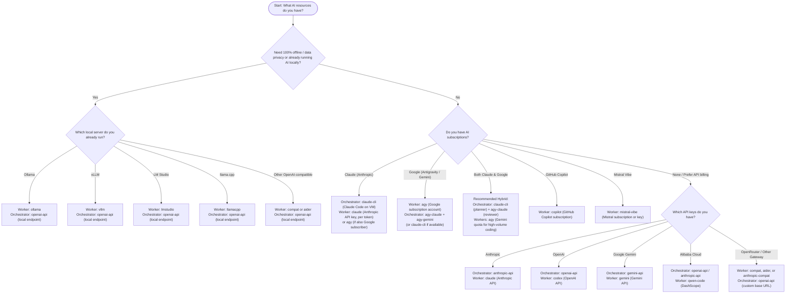

# Choosing an AI for Agent-Forge

Agent-Forge automates software development through an autonomous loop of planning, coding, verification, and code review. Because it runs unattended, picking the right AI models and runtimes determines your operating cost, execution speed, code quality, and privacy.

This guide provides an honest comparison of every supported worker runtime and orchestrator provider so you can choose the setup that fits your workflow and budget.

If you are using the web dashboard, you can also check readiness status interactively. The dashboard's Settings tab now has an Onboarding subsection (Settings > Onboarding) that displays live status for every runtime and provider. It indicates whether each option is configured, missing a host, missing a secret, or untested without reading any code. You can use either this document or the dashboard to determine which AI will work for your setup.

---

## Runtime recommendation in Settings > Onboarding

In addition to viewing readiness status for individual runtimes and providers, the dashboard provides a "pick a runtime for me" recommendation surfaced directly in **Settings > Onboarding** next to the readiness table.

The recommendation is backed by `GET /api/readiness/recommend` (also available via the `bin/foreman readiness-recommend` CLI subcommand). The endpoint returns a JSON payload containing `top`, `ranked`, and `message` fields:

- `top`: An object (`name`, `cost_tier`, `reason`) representing the top recommended runtime among those currently ready, or `null` if no runtime is ready yet.
- `ranked`: A complete list of all evaluated runtimes (`name`, `ready`, `cost_tier`, `note`) ordered according to the ranking rule.
- `message`: An explanatory string returned when no runtime is ready (empty when a top pick is available).

### Ranking rule

The recommendation ranks only worker runtimes that currently pass `bin/lib/foreman/readiness.py`'s own checks (validating that required configuration settings, API keys, and egress proxy rules are present and satisfied):

1. **Readiness separation**: Only runtimes in an `ok` readiness state are eligible to be recommended. Runtimes that are not ready are never ranked ahead of ready runtimes.
2. **Cheapest cost tier first**: Ready runtimes are sorted by cost tier, placing cheaper options ahead of more expensive ones:
   - **Subscription / quota** (`quota`): Account quotas that incur no per-token charges are ranked first.
   - **Pay-per-token** (`metered`): Metered API runtimes are ranked next.
   - **Unknown** (`unknown`): Unpriced runtimes whose costs are not quantified are ranked last among ready runtimes.
3. **Honest fallback**: If no runtime passes its readiness check, the endpoint does not guess or assume a default choice. Instead, `top` is `null` and `message` returns an honest explanation indicating that no runtime is ready yet.

In the dashboard UI, **Settings > Onboarding** displays the top recommendation (`top`) along with its reason, or displays the fallback message if nothing is ready, accompanied by the full ranked list (`ranked`). Which runtime is recommended depends entirely on which models, keys, and egress rules are configured in your specific installation.

---

## Quick decision flowchart

Use this flowchart to find the recommended configuration based on what subscriptions, API keys, or local infrastructure you already have:



---

## Provider vs. runtime: the crucial distinction

Agent-Forge separates high-level coordination from low-level code generation. They run in different places and can use entirely different AIs:

> ### The Orchestrator Provider vs. Worker Runtime Explainer
>
> | Concept | Where it runs | What it does | Configured in | Examples |
> |---|---|---|---|---|
> | **Orchestrator Provider** | Foreman loop (on host machine or VM) | High-level reasoning: breaks goals into tasks (planner), reviews pull requests (reviewer), and verifies acceptance criteria. | `etc/foreman.conf`<br>(`PLAN_PROVIDERS`, `REVIEW_PROVIDERS`) | `claude-cli`, `agy-claude`, `agy-gemini`, `anthropic-api`, `openai-api`, `gemini-api` |
> | **Worker Runtime** | Isolated Docker containers (`worker-N`) | Tactical coding: navigates code, runs terminal commands, edits files, and passes local tests on a task branch. | `bin/worker-add N --runtime <name>` or Settings &rarr; Workers | `agy`, `claude`, `codex`, `gemini`, `compat`, `aider`, `opencode`, `goose`, `qwen-code`, `anthropic-compat`, `copilot`, `mistral-vibe`, `ollama`, `vllm`, `lmstudio`, `llamacpp` |
>
> **You can mix and match.** For example, you can run Claude Code (`claude-cli`) on the host as the orchestrator planner and reviewer because of its strong architectural reasoning, while worker containers run Antigravity (`agy`) to write code against a flat-rate subscription quota without incurring per-token charges.

---

## Worker runtimes comparison

Worker runtimes execute inside locked-down containers. Outbound network traffic is strictly mediated by an egress proxy: standard API runtimes may contact only their provider's public API, while local endpoint runtimes may reach only the configured model server address and port.

| Runtime | One-sentence description | How you get it | Cost model | Egress hosts contacted | Doctor check exists? | Best for |
|---|---|---|---|---|---|---|
| `agy` | Google Antigravity CLI logged into a worker container. | Google account with Antigravity / Gemini subscription (log in once via URL + code). | Quota-based subscription (uses account Gemini/Claude quotas). | Google Antigravity hosts (`egress/allowlist.txt`). | Yes (`bin/doctor` checks `agy /usage` quota and login status). | Gemini subscribers who want unlimited coding runs within subscription limits. |
| `claude` | Anthropic Claude Code CLI running non-interactively with budget controls. | Anthropic API key stored in `anthropic.key` secret. | Per-token (see provider pricing; enforced per-run cap `--max-budget-usd`). | `api.anthropic.com` | Yes (`bin/doctor` checks `anthropic.key` and egress allowlist). | Complex refactoring, highest coding reliability, and strict per-run USD caps. |
| `codex` | OpenAI Codex CLI running non-interactively with quiet flags. | OpenAI API key stored in `openai.key` secret. | Per-token (see provider pricing; estimated via `PRICE_CODEX`). | `api.openai.com` | Yes (`bin/doctor` checks `openai.key` and egress allowlist). | Developers with OpenAI API credits using current OpenAI coding models. |
| `gemini` | Google Gemini CLI running non-interactively with `--yolo` mode. | Gemini API key stored in `gemini.key` secret. | Per-token (see provider pricing; estimated via `PRICE_GEMINI`). | `generativelanguage.googleapis.com` | Yes (`bin/doctor` checks `gemini.key` and egress allowlist). | Pay-per-token Gemini users who do not want to manage Google account logins. |
| `compat` | Codex CLI communicating over OpenAI Responses API to your model server. | Local model server (Ollama 0.13+, vLLM, LM Studio) or OpenRouter; optional `compat.key`. | Free tier / zero token cost on local hardware (`PRICE_COMPAT=0,0,0`); per-token on paid proxies. | Pinned model server host and port only (from `COMPAT_BASE_URL`). | Yes (`bin/doctor` checks `COMPAT_BASE_URL` and egress rule). | Privacy-first setups using local models supporting the OpenAI Responses API. |
| `aider` | Aider CLI connected to any standard OpenAI `/v1/chat/completions` API. | Local model server or OpenRouter; optional `compat.key`. | Free tier / zero token cost on local hardware (`PRICE_COMPAT=0,0,0`); per-token on paid proxies. | Pinned model server host and port only (from `COMPAT_BASE_URL`). | Yes (`bin/doctor` checks `COMPAT_BASE_URL` and egress rule). | Local models lacking Responses API, leveraging Aider's repo-map and auto-test cycle. |
| `opencode` | SST's OpenCode CLI executing tasks non-interactively with JSON streaming. | SST OpenCode installed in worker container; configured provider endpoint in `COMPAT_BASE_URL` (Settings → Workers or `etc/limits.conf`). Pick `opencode` in Settings → "+ Add worker" or `WORKER_RUNTIME`. | Unknown (OpenCode's backend model and pricing are configured in user config, not in Agent-Forge). | Configured model server host only (derived dynamically from `COMPAT_BASE_URL`). | Yes (`bin/doctor` checks `COMPAT_BASE_URL` setting and egress allowlist). | Teams standardized on SST's OpenCode agent toolchain. |
| `goose` | Block's Goose CLI agent executing instructions from stdin on your server. | Block Goose agent in worker container; configured model server in `COMPAT_BASE_URL` (Settings → Workers or `etc/limits.conf`). Pick `goose` in Settings → "+ Add worker" or `WORKER_RUNTIME`. | Unknown (Goose's provider and model pricing are configured in user's Goose environment, not in Agent-Forge). | Configured model server host only (derived dynamically from `COMPAT_BASE_URL`). | Yes (`bin/doctor` checks `COMPAT_BASE_URL` setting and egress allowlist). | Teams using Block's Goose agent architecture with custom extensions. |
| `qwen-code` | Alibaba Qwen Code CLI executing against DashScope models. | Alibaba DashScope API key stored in `qwen.key` secret (`bin/secret-set qwen.key` or in Settings → Workers). Pick `qwen-code` or `qwen` in Settings → "+ Add worker" or `WORKER_RUNTIME`. | Unknown (talks to Alibaba DashScope whose model pricing is not tracked in Agent-Forge). | `dashscope.aliyuncs.com`, `dashscope-intl.aliyuncs.com` | Yes (`bin/doctor` checks `qwen.key` secret and DashScope egress allowlist). | Teams running Qwen-series coding models on Alibaba Cloud DashScope. |
| `anthropic-compat` | Claude Code CLI routed to an Anthropic-compatible gateway or local server. | Model server implementing Anthropic Messages API (LiteLLM, vLLM, Cloudflare); optional `compat.key`. | Unknown unless `PRICE_COMPAT` is configured; zero cost on local hardware. | Pinned model server host and port only (from `COMPAT_BASE_URL`). | Yes (`bin/doctor` checks endpoint configuration and egress rule). | Claude Code workflows running through private enterprise gateways or local proxies. |
| `copilot` | GitHub Copilot CLI executing tasks non-interactively under a GitHub Copilot subscription. | GitHub account with active Copilot subscription (authenticated via `gh` / Copilot CLI). | Covered by a GitHub Copilot subscription (not metered per token in Agent-Forge). | `api.githubcopilot.com`, `api.github.com` | Yes (`bin/doctor` checks Copilot CLI authentication and required egress hosts). | Developers with GitHub Copilot subscriptions using GitHub-supported models. |
| `mistral-vibe` | Mistral Vibe CLI executing tasks non-interactively using Mistral AI models. | Mistral account with Vibe subscription or Mistral API key (`mistral.key`). | Covered by Mistral Vibe subscription or Mistral API key (not metered per token in Agent-Forge). | `api.mistral.ai` | Yes (`bin/doctor` checks `mistral.key` secret and `api.mistral.ai` egress allowlist). | Developers using Mistral AI and Codestral models via Mistral's Vibe CLI. |
| `ollama` | Runs against a local OpenAI-compatible Ollama server pointed at by the owner (no API key). | Local or LAN Ollama server; configure endpoint in `COMPAT_BASE_URL` (no API key needed). | Unmetered — depends on your own hardware rather than a subscription or per-token price. | None needed — traffic stays local/LAN (no public egress allowlist entry needed). | Yes (`bin/doctor` checks whether the configured local endpoint is reachable). | Developers already running local models in Ollama who want zero API costs. |
| `vllm` | Runs against a local OpenAI-compatible vLLM high-throughput server pointed at by the owner (no API key). | Local or LAN vLLM server; configure endpoint in `COMPAT_BASE_URL` (no API key needed). | Unmetered — depends on your own hardware rather than a subscription or per-token price. | None needed — traffic stays local/LAN (no public egress allowlist entry needed). | Yes (`bin/doctor` checks whether the configured local endpoint is reachable). | High-throughput local inference on dedicated GPU workstations running vLLM. |
| `lmstudio` | Runs against a local OpenAI-compatible LM Studio desktop server pointed at by the owner (no API key). | Local LM Studio application serving local models via `COMPAT_BASE_URL` (no API key needed). | Unmetered — depends on your own hardware rather than a subscription or per-token price. | None needed — traffic stays local/LAN (no public egress allowlist entry needed). | Yes (`bin/doctor` checks whether the configured local endpoint is reachable). | Desktop developers already running models locally through LM Studio. |
| `llamacpp` | Runs against a local OpenAI-compatible llama.cpp (`llama-server`) instance pointed at by the owner (no API key). | Local `llama-server` instance; configure endpoint in `COMPAT_BASE_URL` (no API key needed). | Unmetered — depends on your own hardware rather than a subscription or per-token price. | None needed — traffic stays local/LAN (no public egress allowlist entry needed). | Yes (`bin/doctor` checks whether the configured local endpoint is reachable). | Lightweight CPU and GPU inference using llama.cpp quantized GGUF models. |

---

## Deep dive: the three most common choices

### 1. Antigravity (`agy`) for Gemini subscribers

If you subscribe to Google AI / Antigravity, `agy` is the default runtime and the most economical way to run workers.

- **How it works**: Each worker runs inside a `sandbox-worker:1.2.11` container logged in to a dedicated Google account. The supervisor drives the agent using `agy-run` with non-interactive stream-json flags.
- **Cost model**: Quota-based. You pay no per-token fees. Runs consume your subscription's Gemini quota. When quota runs low, `bin/dispatch` pauses that worker automatically until the reset window passes.
- **Quota inspection**: Spend zero model quota checking status. `bin/doctor` queries the local `agy /usage` endpoint to report remaining Gemini and Claude quota percentages.
- **Trade-offs**:
  - Running multiple accounts for a single person's workload can conflict with provider terms (see terms note in [README.md](../README.md)).
  - Account logins expire periodically (typically OAuth tokens refresh, but re-authentication via URL/code is occasionally needed).

### 2. Claude Code (`claude`) for Anthropic subscribers

If you need the highest code generation success rate or already have an Anthropic API key, `claude` is the premier API-based worker runtime.

- **How it works**: Uses the Claude Code CLI inside the `agent-forge-worker-api:1` container. The API key is mounted into the container as a read-only secret (`/run/secrets/api-key`) and injected only into the agent's environment.
- **Cost model**: Per-token billing (see provider pricing). Agent-Forge protects your wallet through defense-in-depth:
  1. **Per-run cap**: Passed directly to the CLI via `--max-budget-usd` (default `$2.00` in `etc/limits.conf`).
  2. **Daily budget**: `API_DAILY_BUDGET_USD` in `etc/limits.conf` (default `$10.00`). If daily spend reaches the cap, API worker dispatch halts immediately.
  3. **Tool & token caps**: Hard cutoffs via `RUN_MAX_TOOL_CALLS` and `RUN_TOKEN_CAP`.
- **Trade-offs**:
  - Higher monetary cost than subscription quotas for continuous 24/7 background operation.
  - Requires setting up API billing and workspace spending limits on the Anthropic Console.

### 3. Local models (Ollama, vLLM, LM Studio, llama.cpp, compat, aider) for privacy & zero token cost

If your company policy prohibits code leaving your network or you already run an AI locally on your own hardware, Agent-Forge provides dedicated runtimes for the most popular local OpenAI-compatible servers as well as generic `compat` and `aider` runtimes.

- **How it works**: Point Agent-Forge at your local model server by setting `COMPAT_BASE_URL` in `etc/limits.conf` or Settings → Workers (e.g., `http://127.0.0.1:11434/v1` for Ollama, `http://gpu-box:8000/v1` for vLLM, `http://127.0.0.1:1234/v1` for LM Studio, or `http://127.0.0.1:8080/v1` for llama.cpp).
- **Picking the right runtime for an AI you already run locally**:
  - **Ollama**: If you already run Ollama, choose `ollama` (`bin/worker-add N --runtime ollama`). Point `COMPAT_BASE_URL` at your Ollama endpoint (e.g. `http://127.0.0.1:11434/v1`). No API key is needed. Cost/quota is unmetered — it depends on your own hardware rather than a subscription or per-token price. Traffic stays local/LAN with no public egress allowlist entry needed. `bin/doctor` checks whether the configured local endpoint is reachable.
  - **vLLM**: If you run vLLM on a dedicated GPU machine or workstation, choose `vllm` (`bin/worker-add N --runtime vllm`). Point `COMPAT_BASE_URL` at your vLLM server (e.g. `http://gpu-box:8000/v1` or `http://127.0.0.1:8000/v1`). No API key is needed. Cost/quota is unmetered — it depends on your own hardware rather than a subscription or per-token price. Traffic stays local/LAN with no public egress allowlist entry needed. `bin/doctor` checks whether the configured local endpoint is reachable.
  - **LM Studio**: If you run LM Studio on your desktop, choose `lmstudio` (`bin/worker-add N --runtime lmstudio`). Point `COMPAT_BASE_URL` at your LM Studio server (e.g. `http://127.0.0.1:1234/v1`). No API key is needed. Cost/quota is unmetered — it depends on your own hardware rather than a subscription or per-token price. Traffic stays local/LAN with no public egress allowlist entry needed. `bin/doctor` checks whether the configured local endpoint is reachable.
  - **llama.cpp**: If you run quantized GGUF models with `llama-server`, choose `llamacpp` (`bin/worker-add N --runtime llamacpp`). Point `COMPAT_BASE_URL` at your server (e.g. `http://127.0.0.1:8080/v1`). No API key is needed. Cost/quota is unmetered — it depends on your own hardware rather than a subscription or per-token price. Traffic stays local/LAN with no public egress allowlist entry needed. `bin/doctor` checks whether the configured local endpoint is reachable.
  - **Other local servers or gateways (`compat` vs `aider`)**:
    - Choose `compat` if your server supports the modern **OpenAI Responses API** (Ollama 0.13+, vLLM, LM Studio 0.3.29+, OpenRouter). It runs the official Codex CLI configured against your endpoint.
    - Choose `aider` if your server only supports standard `/v1/chat/completions`. Aider maintains a project repo-map, performs file editing, and automatically runs your test suite (`TEST_CMD`) after each edit.
- **Cost / quota model**: Unmetered — depends on your own hardware rather than a subscription or per-token price. For `compat` and `aider`, a free tier (`0,0,0` USD per million tokens) applies when running on your own hardware; if pointed at a commercial gateway (like OpenRouter), you can specify `PRICE_COMPAT` in `etc/limits.conf` to track dollar spend.
- **Egress and network**: No public egress allowlist entry is needed for local model servers because traffic stays local/LAN. The egress proxy dynamically directs requests to the configured local endpoint host and port.
- **Doctor check**: `bin/doctor` verifies whether the configured local endpoint is reachable before workers begin running tasks.
- **Trade-offs**:
  - Local models under 30B parameters frequently struggle with multi-file reasoning, repo map navigation, and strict test fixing.
  - Recommended minimum local model: Qwen 2.5/3 Coder 32B Instruct or larger with 32k+ context window.

---

## Orchestrator providers comparison

The orchestrator lives in `bin/foreman`. It calls LLMs sequentially from left to right as configured in `etc/foreman.conf` until one succeeds:

```ini
PLAN_PROVIDERS=claude-cli,agy-claude,agy-gemini
REVIEW_PROVIDERS=agy-claude,claude-cli
```

| Provider | What it uses | Cost model | Strengths | Caveats & Gotchas |
|---|---|---|---|---|
| `claude-cli` | Claude Code (`claude -p`) on host machine. | Subscription-based (free with Claude subscription). | **Best planner.** Stable system prompt caching drastically reduces usage. | Requires Claude Code CLI logged in on the host OS (`claude` &rarr; `/login`). |
| `agy-claude` | Claude via Antigravity worker container. | Quota-based ("Claude and GPT models" quota bucket). | **Best reviewer.** High-fidelity code reviews without paying per token. | The Antigravity Claude quota bucket is small; skips exhausted accounts automatically. |
| `agy-gemini` | Gemini via Antigravity worker container. | Quota-based (uses worker Gemini quota bucket). | Reliable fallback when Claude quotas are temporarily exhausted. | Historically produced inconsistent review verdicts without JSON schema constraints. |
| `anthropic-api` | Direct HTTP call to Anthropic Messages API. | Per-token (see provider pricing). | Unstoppable reliability. Does not depend on host CLI or browser auth. | Costs real money per planning/review call. Configure `ANTHROPIC_API_KEY`. |
| `openai-api` | Direct HTTP call to OpenAI Chat Completions API. | Per-token (or free on local Ollama/vLLM). | Versatile; supports OpenAI models, OpenRouter, or local vLLM instances. | Set `OPENAI_API_BASE` for local/alternative endpoints. Configure `OPENAI_API_KEY`. |
| `gemini-api` | Direct HTTP call to Google Gemini Developer API. | Per-token (see provider pricing). | Direct developer API access without subscription login requirements. | Configure `GEMINI_API_KEY` and `GEMINI_MODEL`. |

---

## Recommended orchestrator setups

### Setup A: The subscription-first setup (Default & Recommended)

Leverages subscriptions you already pay for. Costs $0 in API credits:

```ini
# etc/foreman.conf
PLAN_PROVIDERS=claude-cli,agy-claude,agy-gemini
REVIEW_PROVIDERS=agy-claude,claude-cli
```

- **Planning**: Uses host Claude Code (`claude-cli`) for superior decomposition of goals into tasks.
- **Review**: Uses Antigravity's Claude quota (`agy-claude`) inside worker containers to review pull requests without burning host Claude usage.

### Setup B: The API-backed production team

Ensures the team never stops moving, falling back to paid APIs if subscriptions run out:

```ini
# etc/foreman.conf
PLAN_PROVIDERS=claude-cli,anthropic-api
REVIEW_PROVIDERS=agy-claude,claude-cli,anthropic-api
ANTHROPIC_MODEL=claude-sonnet-5
```

- If Claude Code hits rate limits, the foreman falls back to `anthropic-api` using `ANTHROPIC_API_KEY` stored in `~/.config/sandbox/secrets/ANTHROPIC_API_KEY`.

### Setup C: The 100% private / local setup

No external network calls for planning or reviews:

```ini
# etc/foreman.conf
PLAN_PROVIDERS=openai-api
REVIEW_PROVIDERS=openai-api
OPENAI_MODEL=qwen2.5-coder:32b
OPENAI_API_BASE=http://192.168.1.50:11434/v1
```

- Uses a local server (Ollama, vLLM) for both orchestration decisions and worker coding. Set any non-empty string for `OPENAI_API_KEY`.

---

## What to do next

Now that you have chosen your orchestrator providers and worker runtimes, set up your installation:

1. **Review system prerequisites**: Read [docs/SETUP.md](SETUP.md) for VM sizing (Ubuntu 22.04+, 4+ vCPU, 8+ GB RAM) and baseline installation commands.
2. **Configure limits and providers**: Copy `etc/limits.example.conf` to `etc/limits.conf` and `etc/foreman.example.conf` to `etc/foreman.conf`, adjusting your chosen `PLAN_PROVIDERS` and budgets.
3. **Provision worker containers**:
   - For Antigravity workers:
     ```bash
     bin/worker-add 1
     docker exec -it worker-1 agy-run   # Authenticate with Google account
     ```
   - For Claude Code API workers:
     ```bash
     printf '%s' "$ANTHROPIC_API_KEY" | bin/secret-set anthropic.key
     bin/worker-add 2 --runtime claude
     ```
   - For local model or endpoint workers:
     ```bash
     # Set COMPAT_BASE_URL in etc/limits.conf or Settings, then:
     bin/worker-add 3 --runtime ollama   # or vllm, lmstudio, llamacpp, compat, aider, opencode, goose
     ```
   - For Qwen Code workers:
     ```bash
     printf '%s' "$DASHSCOPE_API_KEY" | bin/secret-set qwen.key
     bin/worker-add 4 --runtime qwen-code   # or select qwen in Settings
     ```
4. **Validate with doctor**: Run `bin/doctor` to verify your tools, proxy enforcement, secret permissions, and worker quota states.
5. **Start your project**: Follow the quickstart steps in [README.md](../README.md) to launch services with `sudo scripts/install-services` and post your first goal via `bin/foreman goal "..."`.
